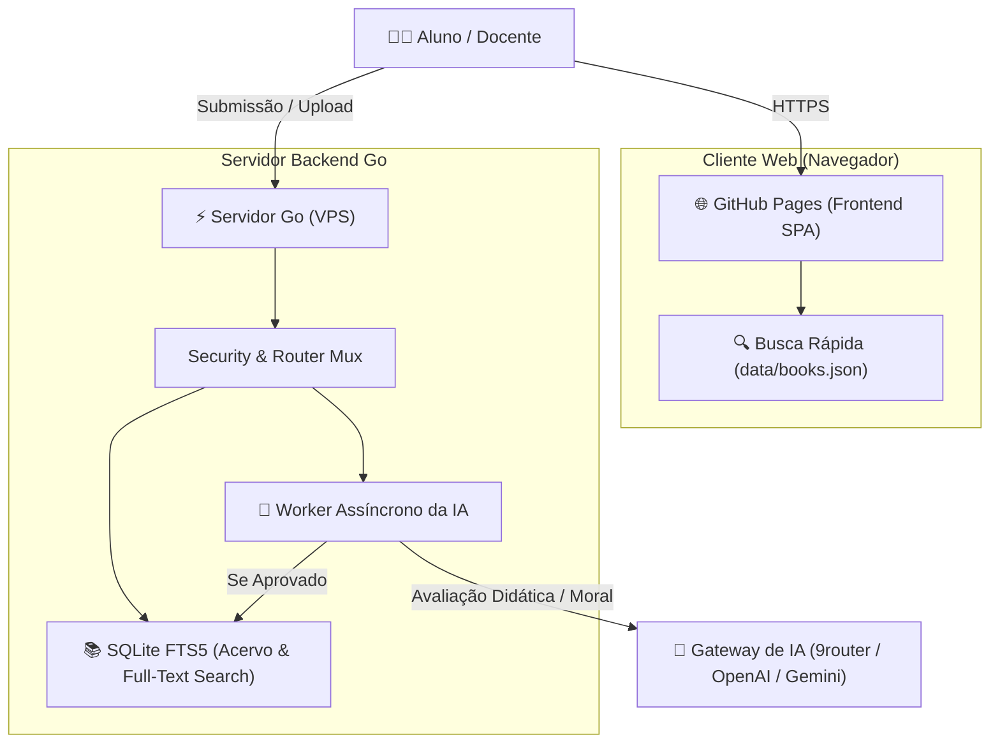

<p align="center">
  
</p>

<h1 align="center">BiblioTânia</h1>

<p align="center">
  <strong>Biblioteca Digital Oficial do Complexo Escolar Privado Betânia · Zango 1, Luanda</strong><br>
  Plataforma educacional aberta de alto desempenho em Go, com SQLite FTS5, acervo curricular nacional (MED/INIDE) e curador de IA.
</p>

<p align="center">
  
  
  
  <a href="https://misterantoy.github.io/biblioteca-betania/"></a>
  
</p>

<p align="center">
  <a href="https://misterantoy.github.io/biblioteca-betania/"><strong>🌐 Acessar Portal Web</strong></a> ·
  <a href="SOBRE.md"><strong>📖 Manifesto Pedagógico</strong></a> ·
  <a href="#-api-rest"><strong>🔌 API REST</strong></a> ·
  <a href="#-execução-rápida"><strong>⚡ Execução Rápida</strong></a>
</p>

---

## ⚡ Performance & Engenharia

| Métrica | Especificação | Impacto Prático |
| :--- | :---: | :--- |
| **Consumo de Memória** | `< 20 MB RAM` | Opera de forma enxuta em servidores modestos ou micro-VPS |
| **Tempo de Resposta** | `< 1 ms` | Consultas de texto integral em milissegundos via SQLite FTS5 |
| **Binário Único** | `~12 MB` | Templates HTML e assets web embutidos nativamente via `go:embed` |
| **Concorrência** | `WAL + sync.RWMutex` | Suporta centenas de leitores simultâneos sem bloqueio (*race-free*) |
| **Dependências Externas** | `Zero` | Dispensa Node.js, npm ou banco de dados externo em produção |

---

## 🏛️ Arquitetura do Sistema

A BiblioTânia adota uma arquitetura híbrida de alta resiliência: o frontend opera estaticamente no GitHub Pages enquanto o backend em Go na VPS processa consultas complexas, triagem de IA e persistência.



---

## 📚 Acervo Curricular Nacional (MED / INIDE)

O acervo reúne **155 obras oficiais e clássicas** com capas físicas (proporção editorial 3:4) e lombada sombreada:

- **Ensino Primário & I Ciclo (1ª à 9ª Classe):** Língua Portuguesa, Matemática, Estudo do Meio, Ciências da Natureza, História e Geografia de Angola.
- **II Ciclo & Pré-Universitário (10ª à 12ª Classe):** Ciências Físicas e Biológicas (CFB), Ciências Económico-Jurídicas (CEJ) e Ciências Humanas.
- **Ensino Técnico de Informática:** Programação (TLP), Redes (RCC), Sistemas Operativos (SEAC) e Bases de Dados (SIBD).
- **Cânone Literário Angolano:** Pepetela, José Luandino Vieira, Agostinho Neto, Ondjaki, Uanhenga Xitu, José Eduardo Agualusa e Paula Tavares.
- **Línguas Nacionais & Cidadania:** Manuais escolares e dicionários em Kimbundu, Umbundu, Kikongo e Cokwe.

### 🎨 Política Editorial: Capas Reais e Autênticas (Zero IA Generativa)
- **Literatura Angolana:** Capas originais digitalizadas de edições históricas (União dos Escritores Angolanos, Editorial Caminho, Leya, Dom Quixote e Cotovia) catalogadas via Open Library.
- **Manuais Escolares:** Fac-símiles oficiais fiéis aos padrões curriculares do Ministério da Educação de Angola / INIDE.
- **Diretriz Absoluta:** É terminantemente proibido o uso de geradores de imagem por inteligência artificial para capas no acervo da BiblioTânia.

*(Consulte o [SOBRE.md](SOBRE.md) para o manifesto pedagógico integral e história institucional).*

---

## 🔌 API REST

Todos os endpoints operam sob cabeçalhos estritos de segurança (`CSP`, `nosniff`, `SAMEORIGIN` e `CORS`).

| Método | Endpoint | Parâmetros Principais | Descrição |
| :---: | :--- | :--- | :--- |
| `GET` | `/api/livros` | `q` (termo), `classe` (1-12), `categoria` | Busca full-text indexada via FTS5 |
| `POST` | `/api/submissoes` | `multipart/form-data` (arquivo ou URL) | Envia livro para avaliação da IA |
| `GET` | `/api/submissoes` | — | Lista o status do Mural da IA |
| `GET` | `/api/stats` | — | Estatísticas do acervo e submissões |

### Exemplo de Consulta:
```bash
# Pesquisar obras de História da 7ª classe
curl -s "http://localhost:8080/api/livros?q=historia&classe=7" | jq .
```

---

## ⚙️ Configuração (Variáveis de Ambiente)

| Variável | Padrão | Descrição |
| :--- | :---: | :--- |
| `PORT` | `8080` | Porta de escuta do servidor HTTP |
| `DB_PATH` | `./data/bibliotania.db` | Caminho do arquivo SQLite com FTS5 |
| `UPLOAD_DIR` | `./uploads` | Diretório para arquivos enviados |
| `MAX_FILE_SIZE_MB` | `50` | Limite máximo por upload de PDF/DOCX |
| `OPENAI_BASE_URL` | `https://api.openai.com/v1` | URL da API de IA (compatível com 9router: `http://127.0.0.1:20128/v1`) |
| `OPENAI_API_KEY` | — | Chave de autenticação no gateway de IA |
| `ADMIN_TOKEN` | `betania-admin-2026` | Token para operações administrativas |

---

## ⚡ Execução Rápida

### Requisitos
- **Go 1.22+** (com CGO habilitado para SQLite nativo)

```bash
# 1. Clonar e entrar no repositório
git clone https://github.com/MisterAntoY/biblioteca-betania.git
cd biblioteca-betania

# 2. Executar testes e checagem de concorrência
go test -v -race ./test/...

# 3. Compilar binário de produção
CGO_ENABLED=1 go build -ldflags="-s -w" -o bin/bibliotania ./cmd/server

# 4. Iniciar o servidor
PORT=8080 ./bin/bibliotania
```

Servidor disponível em: **`http://localhost:8080`**

---

## 📜 Licença e Governança

Desenvolvido para o **Complexo Escolar Privado Betânia - Zango 1** (Luanda, Angola).  
Código aberto sob a licença **Apache 2.0**.
