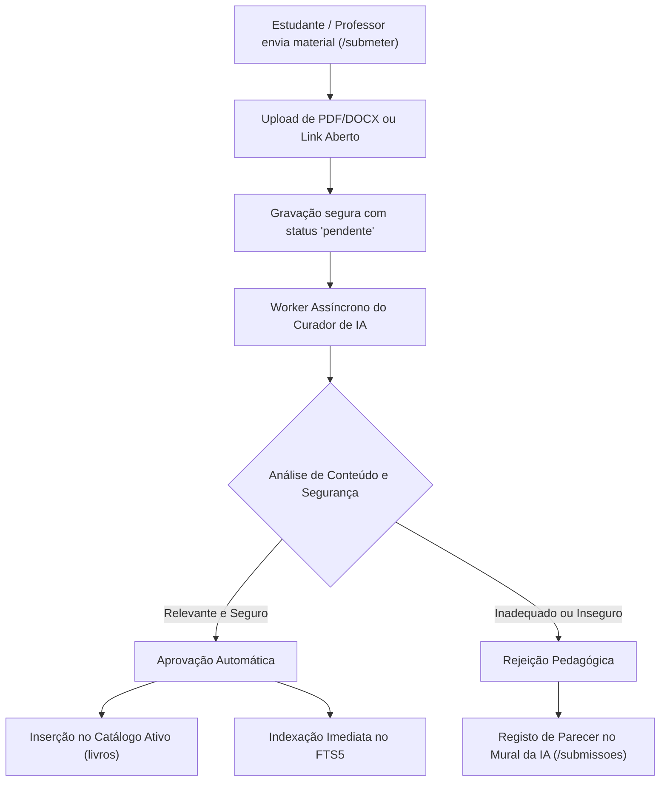

# 📖 BiblioTânia — Biblioteca Digital do Colégio Betânia
## Documento Institucional, Pedagógico e Manifesto do Conhecimento Aberto

> *"Educação Aberta, Tradição Angolana e Inovação Tecnológica ao Serviço da Comunidade Escolar."*

---

## 🏛️ 1. Apresentação e Origem Institucional

A **BiblioTânia** é a plataforma oficial de biblioteca digital do **Colégio Betânia**, criada para democratizar o acesso universal ao conhecimento, aos manuais escolares oficiais e à literatura nacional e internacional de forma perene, aberta e gratuita.

O projeto nasceu de uma decisão estratégica tomada em conjunto com a Direção do Colégio Betânia: evoluir a experiência precursora da iniciativa *lino.livre* e conceber uma biblioteca digital com identidade institucional própria, perfeitamente adaptada ao currículo de Angola e vocacionada para a comunidade escolar de Luanda.

A meta suprema da BiblioTânia é estabelecer a infraestrutura necessária para suportar o marco de **100 milhões de livros digitais e recursos educacionais abertos (REA)**, garantindo que nenhum estudante do Colégio Betânia fique privado de materiais de estudo de excelência por restrições financeiras ou geográficas.

---

## 🎯 2. Missão, Visão e Princípios Pedagógicos

### Missão
Fornecer a estudantes, professores, investigadores e encarregados de educação uma plataforma digital ultrarrápida, segura e acessível a partir de qualquer dispositivo (computadores escolares, tablets ou telemóveis), reunindo manuais curriculares certificados, literatura de referência e manuais práticos de capacitação técnica e comunitária.

### Visão
Consolidar o Colégio Betânia como uma instituição de ensino de vanguarda em Angola e no continente africano, aliando a solidez da tradição pedagógica ao rigor da soberania tecnológica e da Inteligência Artificial aplicada à educação.

### Princípios Norteadores
1. **Gratuidade e Acesso Universal:** O acesso ao saber é um direito de cada estudante. O catálogo está aberto a toda a comunidade sem paywalls, publicidades invasivas ou registos burocráticos.
2. **Valorização da Identidade e Cultura Angolana:** Prioridade absoluta às obras de autores angolanos, à história pátria, à transmissão de tradições orais e ao ensino das línguas nacionais.
3. **Coautoria e Participação Ativa do Estudante:** Os alunos não são meros consumidores de conteúdo; através do módulo de submissão, atuam como agentes ativos na expansão do acervo da sua própria escola.
4. **Sustentabilidade Tecnológica e Eficiência:** Rejeição do desperdício computacional; o sistema é desenhado para operar com consumo mínimo de energia, memória e processamento.

---

## 📚 3. Estrutura Curricular e Acervo Escolar

O acervo da BiblioTânia está estruturado em estrita conformidade com os programas oficiais aprovados pelo **Ministério da Educação de Angola (MED)** e pelo **Instituto Nacional de Investigação e Desenvolvimento da Educação (INIDE)**:

### 3.1. Ensino Primário (1ª à 6ª Classe)
Focado na alfabetização, numeracia fundamental e conhecimento do meio circundante:
- **1ª e 2ª Classes:** Manuais de Língua Portuguesa (iniciação à leitura e caligrafia), Matemática Básica (noções de cálculo e geometria) e Estudo do Meio (higiene, família e escola).
- **3ª e 4ª Classes:** Língua Portuguesa (leitura e ortografia), Matemática Elementar e Ciências da Natureza.
- **5ª e 6ª Classes:** Língua Portuguesa (leitura e produção escrita), Matemática, Ciências da Natureza (ecologia e seres vivos), História de Angola e Geografia de Angola.

### 3.2. Ensino Secundário Geral — I Ciclo (7ª à 9ª Classe)
Consolidação do pensamento crítico e introdução às disciplinas científicas fundamentais:
- **Língua Portuguesa e Literatura Escolar**
- **Matemática** (Álgebra, Geometria e Estatística Elementar)
- **Física Fundamental** (Cinemática, Dinâmica e Energia)
- **Química Geral** (Matéria, Átomos e Transformações Químicas)
- **Biologia Geral** (Morfologia e Fisiologia Celular)
- **História e Geografia de África e do Mundo**
- **Educação Moral e Cívica**

### 3.3. Ensino Secundário Geral — II Ciclo / Pré-Universitário (10ª à 12ª Classe)
Divisão por áreas de especialização para ingresso no ensino superior:
- **Ciências Físicas e Biológicas (CFB):**
  - Matemática Avançada (Cálculo Diferencial e Integral, Sucessões, Limites e Trigonometria).
  - Física Superior (Eletromagnetismo, Termodinâmica e Física Moderna).
  - Química Orgânica e Analítica (Cinética, Equilíbrio Químico e Bioquímica).
  - Biologia Molecular, Genética, Evolução e Ecossistemas de Angola.
  - Geologia e Recursos Minerais de Angola.
- **Ciências Económicas e Jurídicas (CEJ):**
  - Introdução à Economia, Mercados, Moeda e Comércio Internacional.
  - Noções de Direito, Ordem Jurídica Angolana e Direito do Trabalho.
  - Sociologia da Sociedade Angolana e Filosofia Política e Ética.

### 3.4. Ensino Técnico-Profissional (Informática e Tecnologias)
Formação prática orientada para as exigências do mercado tecnológico moderno:
- **TLP — Técnicas e Linguagens de Programação:** Lógica de algoritmos, estruturas de dados e programação moderna.
- **RCC — Redes de Comunicação e Computadores:** Protocolos TCP/IP, encaminhamento, modelo OSI e segurança de redes.
- **SEAC — Sistemas de Exploração e Arquitetura de Computadores:** Funcionamento de processadores, gestão de processos e memória no Linux/POSIX.
- **SIBD — Sistemas de Informação e Bases de Dados:** Modelação relacional, álgebra relacional, normalização e consultas em SQL.

### 3.5. Tesouro da Literatura e Cultura Angolana
O acervo reúne os nomes mais expressivos da literatura nacional:
- **Clássicos Fundacionais:** Agostinho Neto (*Sagrada Esperança*), António Jacinto, Viriato da Cruz, Mário Pinto de Andrade, Deolinda Rodrigues.
- **Mestres da Narrativa e Ficção:** Pepetela (*Mayombe*, *Yaka*, *A Revolta da Casa dos Ídolos*, *A Cidade e a Infância*), José Luandino Vieira (*Luuanda*, *A Vida Verdadeira de Domingos Xavier*, *Nós, os do Makulusu*, *Velhas Estórias*), Uanhenga Xitu (*Mestre Tamoda*, *Bola com Feitiço*, *Manana*, *Vozes da Terra*), Manuel Rui (*Quem Me Dera Ser Onda*, *Crónica de um Mujimbo*), Arnaldo Santos (*O Cão e os Caluandas*), Boaventura Cardoso (*O Signo do Fogo*).
- **Vozes Contemporâneas de Prestígio Internacional:** Ondjaki (*Bom Dia Camaradas*, *Os Transparentes*, *AvóDezanove e o Segredo do Soviético*), José Eduardo Agualusa (*Teoria Geral do Esquecimento*, *O Vendedor de Passados*, *Nação Crioula*, *As Mulheres do Meu Pai*, *A Sociedade dos Sonhadores Involuntários*), Paula Tavares (*Ritos de Passagem*, *Dizes-me Coisas Amargas Como os Frutos*).

### 3.6. Línguas Nacionais de Angola
Preservação e promoção do património linguístico angolano através de gramáticas pedagógicas, diálogos escolares e dicionários didáticos:
- **Kimbundu:** Gramática Elementar da Língua Kimbundu e Dicionário Didático Português-Kimbundu.
- **Umbundu:** Introdução ao Umbundu Escolar e Dicionário Básico Umbundu-Português.
- **Kikongo:** Noções Elementares da Língua Kikongo para o Ensino.
- **Cokwe:** Provérbios, Fábulas e Tradições Orais em Cokwe.

### 3.7. Manuais de Apoio Comunitário, Saúde e Agropecuária
Obras de utilidade pública para os desafios reais das comunidades:
- **Saúde Preventiva:** Prevenção e Tratamento da Malária e Doenças Hídricas em Angola, Primeiros Socorros Escolares e Guia de Nutrição Infantil com Alimentos Tradicionais.
- **Sustentabilidade Rural:** Guia Prático do Cultivo da Mandioca, Milho e Feijão em Angola, Horticultura Escolar e Manejo de Solos Tropicais, Criação Sustentável de Pequenos Ruminantes e Gestão das Bacias Hidrográficas do Kwanza e Cunene.

---

## 🎨 4. Experiência Visual e Identidade do Colégio Betânia

A interface da BiblioTânia foi desenhada para proporcionar a sensação nobre de uma estante de biblioteca tradicional, incorporando os padrões de identidade visual do Colégio Betânia:

- **Paleta Cromática Institucional:**
  - **Azul Marinho Betânia (`#0B1E3B`):** Transmite estabilidade, sobriedade e prestígio académico.
  - **Ouro Académico (`#D97706` / `#F59E0B`):** Simboliza a luz do conhecimento, a sabedoria e a excelência educacional.
  - **Superfícies de Leitura:** Fundo claro com contraste otimizado (`#F8FAFC` / `#FFFFFF`), tipografia serifada e sem serifa que garantem legibilidade sem fadiga visual em sessões prolongadas de estudo.
- **Capas Editoriais Físicas (Proporção 3:4):**
  - Cada livro do catálogo possui uma capa exclusiva gerada na proporção editorial clássica de 3:4.
  - Detalhe de **lombada curva sombreada** à esquerda que simula o encadernamento tradicional de um livro físico.
  - Efeito tridimensional suave ao passar o cursor (*hover 3D* com elevação e sombra projetada).
  - Brasão oficial do Colégio Betânia e selo do Ministério da Educação / INIDE apostos nas obras curriculares.

---

## 🤖 5. O Curador de Inteligência Artificial

A expansão do catálogo da BiblioTânia assenta num modelo colaborativo seguro. Estudantes e professores podem sugerir obras a qualquer momento através do formulário de submissão (`/submeter`).

Para garantir que a biblioteca preserve o mais elevado padrão ético e pedagógico sem criar sobrecarga de trabalho manual para os professores, implementou-se o **Curador de IA**:

### Critérios de Avaliação do Curador:
1. **Relevância Pedagógica:** Adequação ao ensino primário, secundário, técnico ou superior em Angola.
2. **Segurança e Proteção Infantil:** Rejeição intransigente de conteúdos que envolvam violência, apologia ao ódio, pornografia, exploração, malware, apostas ou fraude comercial.
3. **Qualidade do Ficheiro:** Verificação de integridade estrutural do ficheiro (PDF ou DOCX legível, sem corrupção).
4. **Resiliência Heurística:** Na eventual ausência de ligação com provedores de IA externos, o sistema ativa um motor de **Heurística Educacional Local**, garantindo funcionamento ininterrupto 24/7.

---

## ⚡ 6. Arquitetura Tecnológica e Engenharia de Software

Em linha com a directriz de simplificação e redução drástica de custos operacionais, o projeto substituiu abordagens pesadas em JavaScript/Node.js por uma arquitetura em **Go (Golang)**:

| Característica | Next.js / Node.js Tradicional | BiblioTânia em Go |
| :--- | :--- | :--- |
| **Consumo de Memória RAM** | 300MB – 800MB | **Menos de 25MB** |
| **Arranque e Prontidão** | 5 a 15 segundos | **Inferior a 100 milissegundos** |
| **Distribuição e Execução** | Centenas de pastas `node_modules` | **Binário único estático (~12MB)** |
| **Pesquisa Textual** | Exige Elasticsearch / Meilisearch externo | **SQLite FTS5 embutido no binário** |
| **Manutenções Periódicas** | Constantes vulnerabilidades em pacotes npm | **Zero dependências externas em execução** |
| **Resistência a Falhas** | Elevada complexidade de orquestração | **Processo autónomo de alta tolerância** |

### Garantias de Segurança Rigorosas:
- **Imunidade a SQL Injection:** 100% das leituras e escritas são parametrizadas com placeholders preparados. A pesquisa FTS5 conta com sanitização léxica estrita contra caracteres de escape.
- **Proteção contra Cross-Site Scripting (XSS):** O motor de templates de Go aplica escape contextual obrigatório em todo o HTML gerado.
- **Prevenção de Race Conditions:** Mutex de leitura/escrita (`sync.RWMutex`) serializa transações de escrita e viabiliza centenas de leituras simultâneas sem bloqueio. Testado com `go test -race`.
- **Upload Blindado:** Nomes de ficheiros substituídos por hashes UUID/SHA-256 criptográficos, validação de cabeçalhos mágicos (MIME sniffing real) e corte de requisição em 50MB.
- **Proteção contra SSRF:** Links externos de alunos são validados para impedir conexões a endereços locais (`localhost`, `127.0.0.1`, IPs de rede privada).

---

## 📖 7. Guia do Utilizador (Estudantes e Professores)

### Como Pesquisar Livros
1. Aceda à página inicial em `http://localhost:8090/` (ou pelo endereço Tailscale / IP da rede escolar).
2. Utilize os botões de filtro rápido para navegar por:
   - **Ciclos e Classes:** 1ª até à 12ª Classe.
   - **Áreas Temáticas:** Literatura Angolana, Línguas Nacionais, Informática, Saúde Comunitária e Agropecuária.
3. Digite termos na barra de pesquisa (o motor FTS5 pesquisa instantaneamente no título, autor, disciplina, nível e descrição pedagógica).

### Como Ler uma Obra
1. Ao encontrar o livro desejado, clique no botão **"Ler Livro / Abrir Obra"**.
2. Obras em PDF ou links de livre acesso abrem de imediato no navegador ou no visualizador integrado, sem necessidade de programas adicionais.

### Como Submeter um Novo Livro
1. Clique no botão de destaque **"Sugerir / Enviar Livro"** no menu superior.
2. Preencha os seus dados de identificação escolar (Nome e Classe/Turma).
3. Indique o Título, Disciplina e Nível de Ensino da obra.
4. Anexe o ficheiro (PDF ou DOCX até 50MB) ou cole a hiperligação pública segura (HTTPS).
5. Clique em **"Submeter para Triagem da IA"**.
6. Acompanhe a decisão em tempo real na página **"Mural da IA"** (`/submissoes`).

---

## 🏛️ 8. Governança e Informações Institucionais

- **Instituição:** Colégio Betânia — Luanda, Angola.
- **Projeto:** BiblioTânia — Plataforma de Conhecimento Aberto.
- **Ambiente de Hospedagem:** Servidor VPS Dedicado de Alto Desempenho.
- **Licenciamento do Código:** Código fonte aberto para fins pedagógicos sob licença permissiva Apache 2.0.
- **Direitos dos Autores:** As obras catalogadas são provenientes de Domínio Público, Recursos Educacionais Abertos (REA) e materiais de divulgação científica e educacional livre.

---
*BiblioTânia — Onde o saber tradicional de Angola encontra a inteligência do futuro.*
